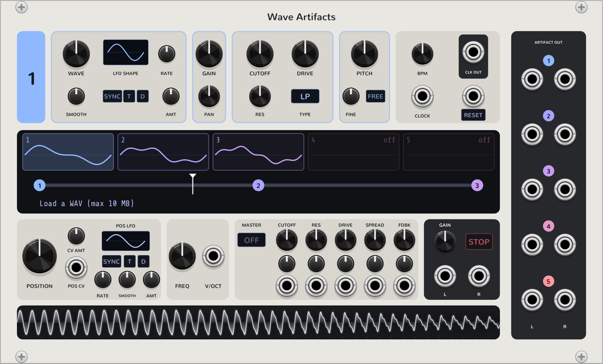
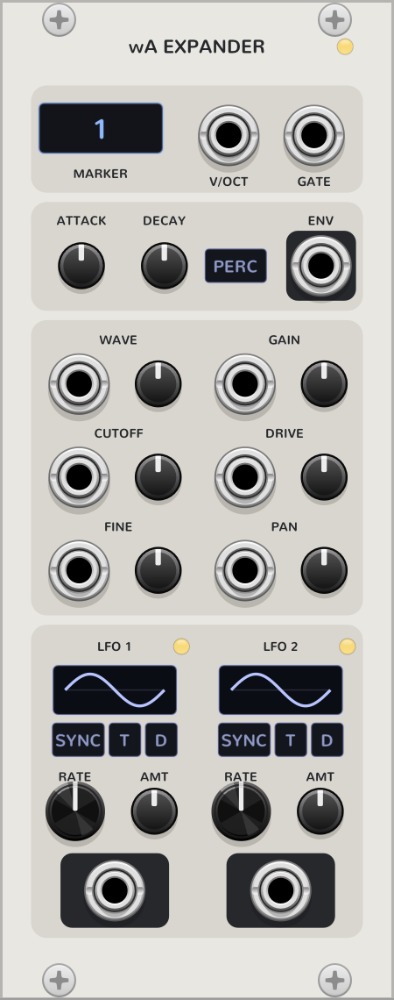

# Wave Artifacts

A VCV Rack 2 wavetable morph oscillator. It turns one imported WAV file (max 10 MB) into
50-100 single-cycle wavetables ("artifacts") and morphs between up to 5 user-placed markers.
A wavetable map along the bottom shows the whole sample, with each marker's bullet at the
artifact it plays. The **Wave Artifacts Expander** (up to 5, to the right) adds per-marker CV
inputs, a gate, and the marker's own LFO and AD envelope (each sent to a setting, lockable per trig).



*Wave Artifacts as it looks before a WAV is loaded. Top row: the selected marker's controls,
then the tempo section. Middle: the marker bar (the five slots, the bullets and the playhead).
Bottom: POSITION and its LFO, FREQ / V/OCT, the master section and the wavetable map.
Right: each artifact's SEND and RETURN.*

**SEND / RETURN (right column, one row per artifact, numbered in its color): put any module in place of an
artifact's filter.** SEND carries what the artifact's filter gets (after GAIN and DRIVE; on WAVE in MORPH, at its
share of the position crossfade). Patch it through a filter (or any effect) back into the row's RETURN: the
returned sound takes the filter's place (a 20 ms crossfade, no click), and everything after the filter goes on
as before: the envelope, GAIN, PAN, the main mix, the master filter and the limiter. The voice stays in the main
L/R. With RETURN unpatched the artifact keeps its own filter (patching only SEND changes nothing). The screen tags
an artifact **RET** while its return replaces its filter.

- **Stereo on one cable.** SEND has 2 channels (a poly cable): left, right. A poly module (VCV VCF, Vult Freak,
  Surge XT's filters...) filters both and answers with 2 channels on RETURN: the voice stays stereo (a stereo
  sample, grain SPREAD).
- **A mono module works too** (Vult Freak-HW, most hardware clones): it reads one channel and answers with one.
  The artifact notices (one channel back for 5 ms) and its SEND carries left + right on one channel from then on,
  so the module gets the whole voice; the one returned channel feeds both sides. Unplug the RETURN (or the SEND)
  to go back to stereo, e.g. after swapping in a poly module.
- The loop goes through one Rack cable, one sample late (0.02 ms).
- SEND / RETURN replace the earlier ARTIFACT OUT jacks (separate outputs per artifact). Cables to those jacks are
  dropped when an old patch loads.
- **Separate L / R jacks: wA SEND / RETURN.** For a stereo effect with two mono inputs and outputs (most reverbs and
  delays), add *Wave Artifacts Send / Return* (right-click Wave Artifacts > *Add stereo send / return*, or from the
  browser) at the end of the expander chain: right of the last expander, or right of Wave Artifacts when there is
  none. One row per artifact: **SEND L, SEND R** (on the dark box) and **RET L, RET R**. It does what the main
  panel's SEND / RETURN does: the returned sound takes the artifact's filter's place (the same crossfade, RET tag and
  note envelope after it). Normalled as on hardware: with SEND R unpatched SEND L carries the whole voice (L + R),
  and with RET R unpatched RET L feeds both sides, so a mono effect needs only the L jacks. When an artifact's RET L
  is patched here, it wins over the main panel's RETURN for that artifact. The loop goes through the expanders'
  links, so it is a few samples late: 3 next to Wave Artifacts, 2 more per expander in between (0.06 ms at 48 kHz).
  Its light is on while it is linked; unlinked, it says where to put it.

The plugin and module slugs stay `waveArtifact` and `waveArtifactExpander`, so patches saved
with earlier builds still load.

Status: playable. Oscillator, markers, per-artifact controls, master filter, internal tempo and
clock, per-artifact send / return and the expander (CV, gate, the marker's LFO and AD) are done.

**The loaded WAV is saved inside the patch.** Saving a patch (or Rack's autosave) keeps a copy of the WAV in the
patch file, with its original path, the artifact count and the tone. Opening the project loads it again, also on
another computer or after the original file moved. If the patch's copy is missing, the original file is loaded
from where it was; if neither is there, the screen says *Sample not found*. A patch grows by the WAV's size
(10 MB at most).

## Quick start: your first patch

You need Wave Artifacts, something that sends pitch (and optionally a gate), and an audio
output. The smallest patch is just Wave Artifacts into **Audio**, which already makes sound.

1. **Add the module.** Right-click the rack, search for *Wave Artifacts* and add it.
2. **Load a WAV.** Click the screen where it says *Load a WAV (max 10 MB)* (or the file line
   at the bottom of the screen later on), or right-click the module and choose **Load WAV (main sample)...**
   Any WAV works: a voice, a pad, a field recording. The module analyses it for a moment and
   the file line then shows the name and the number of artifacts, e.g. `pad.wav  64 artifacts`.
   The **◀ ▶** arrows at the right end of the file line load the previous or next WAV in the
   same folder, sorted by name and wrapping around (also in the right-click menu).
3. **Patch the output.** Cable **L** and **R** (bottom right of the main section, in the dark
   box next to STOP) to an **Audio** module's left and right inputs.
4. **Hear it.** The module starts with one marker, so you hear one wavetable at a steady pitch
   (C4 with the FREQ knob in the middle).
5. **Add markers.** Click an empty spot on the marker bar (the line with the bullets) to add a
   marker there, up to five. Each new marker picks the artifact under that spot of the sample.
6. **Move through them.** Turn **POSITION**, or drag the white playhead on the bar. The sound
   crossfades between the two markers the playhead is between. Drag a bullet to move a marker.
7. **Shape each marker.** Click a slot at the top of the screen (or a bullet) to select a
   marker. The panel's top row now edits that marker: WAVE (which artifact it plays) and its
   SMOOTH, the WAVE LFO, GAIN and PAN, CUTOFF / DRIVE / RES / filter TYPE, and PITCH / FINE.
   You can also click the wavetable map along the bottom to give the selected marker that
   artifact; double-click an artifact to audition it, right-click it to assign it to a marker.
   To start a marker from another one, right-click the first (its slot or bullet), choose **Copy
   settings**, then right-click the other and choose **Paste settings of marker N**. Every setting
   of both engines is overwritten, including WAVE / START; the marker keeps its on/off state and its
   place on the bar. Ctrl+Z undoes a paste. CV patched on an expander stays with its marker.
   **Double-click a marker's bullet on the bar to mute it** (again to unmute; also in its right-click menu). A muted
   marker turns grey, keeps its number, place and settings, and makes no sound on either engine, its own output
   included. It fades out and in over 5 ms, so muting while playing does not click. Ctrl+Z undoes it.
   **Shift + a control moves that setting on every marker at once.** Hold Shift and drag any knob in the
   per-marker section (START, GAIN, CUTOFF, the envelope and so on). Every active marker moves by the same
   amount from where it is, so the differences between them stay; if one hits its limit, moving back restores
   the spacing. When the knob you are holding reaches its own limit, keep dragging: it stays there and the
   others carry on until each reaches its limit (not in Rack's rotary knob modes). Shift-clicking a choice (filter TYPE, SYNC, the LFO or WINDOW screen) sets them all to the same
   value. **Shift + double-click a knob resets that setting to its default on every active marker.** Knobs keep their normal speed, Ctrl + Shift is the fine version, and Ctrl+Z undoes the whole move.
8. **Play it.** Cable a keyboard or sequencer's **1V/oct** to **V/OCT** (0 V is C4). Turn the
   POSITION LFO's AMT up to have the playhead move on its own; with SYNC on it follows the
   internal tempo (BPM) or a clock patched to **CLOCK**.
9. **Finish the sound** with the master section: pick a filter type (OFF / LP / BP / HP /
   NOTCH), then CUTOFF, RES, DRIVE, SPREAD and FDBK, each with its own CV trimpot and jack,
   and the master GAIN with its own **AMT** trimpot and **CV** jack (a VCA: GAIN at 0%, AMT at
   100%, then 0-10 V = 0-200%; negative AMT ducks). The red **!** bullet (STOP) fades every output to silence
   until you press it again.

Useful to know:

- **POS CV / CV AMT** move the playhead from a CV (0-10 V sweeps the whole bar).
- **NOTCH** (artifact and master filter) cuts a wide hole at CUTOFF. RES adds two resonant
  peaks on its sides (up to about +7.6 dB at full RES) while the hole stays fully deep. Sweep
  CUTOFF slowly (or modulate it from the expander) to hear it move through the harmonics.
- **RESET** (or a gate on the RESET jack) restarts the beat grid and every LFO; **CLK OUT**
  sends a 10 V trigger per beat.
- Right-click menu: *Artifact count* (50 / 64 / 100 or Auto), *Artifact tone* (Natural /
  Smooth / Soft), *Clock resolution* for the CLOCK input, *Restart LFOs* and *Add expander*.
- **Randomize** (right-click menu) leaves the STOP button alone and also randomizes the
  expanders snapped on to the right.
- To give each artifact its own filter or effect, patch its **SEND** through the module into its **RETURN**
  (right column, one row per artifact).

## One sample per artifact

Every artifact plays the **main sample** (the one loaded on the screen) until you give it its own: up to five
different WAVs at once, one per artifact, on every engine and in every play mode.

- **Load one:** right-click the artifact's slot on the screen and choose **Load a sample for it...** (or right-click
  the module: **Artifact samples > Artifact N**). The slot then shows a **WAV** tag. **Use the main sample** gives it
  back the main one; *Previous / Next WAV in its folder* step through its folder.
- **The screen follows the selected artifact:** with an artifact selected that has its own file, the map, the hits,
  the file line and its ◀ ▶ arrows are that file's, and clicking the file line loads into that artifact. Only the
  markers on the shown file appear on the map.
- **WAVE:** each artifact's WAVE picks a table of its own file; MORPH glides from one file's timbre into the
  other's. **GRAIN / SAMPLE:** each cloud reads its own file, and START, LENGTH, LOOP POINT and HIT are in that file
  (a slice ends at the next START *on the same file*). **POLY, STEP, ALL** play each artifact's note from its file;
  in **SEQ** each row plays its artifact's file (a small kit: kick, snare, hat ...).
- **Loading while it plays:** only that artifact fades out (5 ms) and back in on the new file; the others keep
  playing. Loading the main sample fades everything, as before.
- **Saved with the patch:** each file is copied into the patch's folder like the main one, so the project opens
  without the originals. *Artifact count* and *Artifact tone* apply to every file (changing them analyses each one
  again). *Spread the markers over the transients* uses each artifact's own file.

## Play modes: MORPH and POLY

The **MORPH | POLY** button (PLAY, in the strip under the artifact knobs) chooses what the POSITION playhead does, on both engines.

**MORPH** (the default) is one voice: the playhead crossfades between the two neighboring markers.

**POLY** makes each marker its own voice, so up to five sound together:

- The playhead **starts a marker's note when it reaches it**, from either direction. A jump (a saw LFO's
  reset, a square, a fast knob move) starts only the last marker it passes. POS CV and the POS LFO count too;
  the POS LFO's SMOOTH does not affect the notes.
- Each note **plays for its own length (H, HOLD), whatever the playhead does next**, so notes sound together.
  The same marker reached again restarts its note. The marker nearest the playhead plays once when you enter
  POLY. With H fully up, a note stays on until the playhead starts another marker, so a stopped playhead drones.
- **A, D, S, H, R** set the selected marker's envelope: attack 1 ms to 5 s, decay and release 5 ms to 10 s,
  sustain 0-100%, hold 10 ms to 10 s. The little screen shows the shape. For a pluck, turn S down and D short.
  They only appear in POLY. To use one envelope everywhere, right-click a marker: **Copy ADSR to all markers**.
- A level bar on each marker's slot shows which voices are sounding.
- **Play a marker directly, without POSITION.** Patch a gate to the **GATE** of an expander set to that marker:
  the note starts when the gate rises, holds while it is high (H does not apply) and releases when it falls. That
  marker then ignores the playhead; the others keep following it. For a keyboard or pads, Rack's MIDI-Gate module
  gives each note its own gate output. In POLY the expander's AD runs on each note, on its DEST.
- **Or hold a marker's slot down** on the screen: it plays until you let go, and selects the marker as usual.
- Every marker keeps its own WAVE, filter, drive, pan and pitch, with nothing blended between markers.
- Markers on the same spot of the bar start together, as a chord. V/OCT still sets one note for the module.
- An artifact's SEND / RETURN carries its own note: the returned sound gets the note's envelope after it.
- On GRAIN, a note starts at once (even with SYNC) with its grains already overlapping, so a short attack is
  heard however long the grains are. Free SCAN restarts from START with each note.
- One or two voices play at full level; beyond that they share the headroom.

Copy / paste carries the ADSR too.

**STEP** (press the PLAY button a second time) plays the markers in turn from the POS LFO's clock instead of the
playhead: every cycle of the POS LFO is one step, and step 1 plays the leftmost marker on the bar, step 2 the next
one, and so on, wrapping round. With the POS LFO's SYNC on, RATE sets the step length: at 1/2, marker 1 plays on
the first half note, marker 2 on the second. POSITION and the POS LFO's AMT do not matter here; the playhead jumps
to show the marker playing. Markers that are off or muted are skipped, and RESET starts again from the leftmost.
Each note keeps its marker's own ADSR and sound. H sets its length; **H fully up keeps it on until that marker's next
turn**, so every marker keeps sounding and each is struck again on its own step.

**ALL** (the fourth press of PLAY) is the same clock, but every cycle plays every marker together: a chord on each
POS LFO cycle. With H fully up, every marker sounds all the time, struck again on each cycle, whatever the position.
Off and muted markers stay silent. Expander GATEs and slot presses still
play their marker directly.

## The step sequencer (SEQ)

For a drum-machine style pattern, right-click Wave Artifacts and choose **Add step sequencer (SEQ mode)** (or add
*Wave Artifacts Sequencer* from the module browser and snap it to the **left**; the expanders go on the right).
Then press PLAY until it shows **SEQ**. SEQ plays nothing until a sequencer is snapped on.

- **The grid:** one row per marker (its color), 16 steps. **Draw steps by dragging**: press on a step and drag along
  the row, and every step you pass is switched on at the height of the mouse (the top of a cell is 100%). Drag up and
  down to set a velocity; dragged all the way to the bottom of the cell, a step switches off (silent). **Click** a step to select it (see parameter locks below), **double-click** a step to switch
  it off, or hold Shift and drag along a row to erase the steps you pass. Click outside the steps (or on an empty part of the main module) to deselect.
- **Clock:** the module's own clock: the **CLOCK input** when something is patched, otherwise the **internal tempo**
  (BPM). The POS LFO is not involved. RESET goes back to step 1 on every row and plays it at once. A white frame
  shows each row's current step.
- **Clock per row:** the **CLOCK** knob left of each row multiplies (to the right) or divides (to the left) the
  module's clock for that row: /8 /4 /3 /2 | x1 | x2 x3 x4 x8, where x1 is a step per beat (quarter note), the
  default x4 gives 16th notes, and /2 a step every two beats. Rows at different speeds drift against each other.
- **Length per row:** Ctrl + click a step to end that row there (1 to 16), or use the right-click menu; rows of
  different lengths drift against each other (polyrhythms). Steps past the end are shown dimmed. The length shows
  next to the row's number, left of its CLOCK knob.
- **LAY and RND (SAMPLE and GRAIN), under each row's number:** **LAY** lays the marker's loop out on its row, a trig on each
  hit (the guessed length; see *Lay out the loop on the row* in the SAMPLE section); right-click it for every step and
  the other lengths. **RND** gives the row's trigs random slices of that loop: each gets the START of one of the
  slices LAY makes and a LENGTH up to the row's next trig, so the rhythm, velocities and conditions stay and only
  what plays is shuffled. Step 1 always stays (the downbeat). How many trigs change: the **RND amount slider** at the
  top right (100 %: all of them). To change only some, **Ctrl + Shift + click** steps (or Ctrl + Shift + drag along a row) to mark them
  (corner brackets; RND is outlined then); a plain click anywhere on the grid clears the marks. Both are undone with
  Ctrl + Z, and are dimmed when they cannot act (not SAMPLE, the marker off, or no Wave Artifacts on the right).
- **A row whose marker is off** is dimmed and plays nothing (no trigs, its GATE closed, its MOD at 0 V), but keeps
  time: turn the marker on again and the row comes in on the right step. Its steps can still be edited.
- **Copy / paste a trig:** with the mouse over a trig (or a trig selected), **Ctrl + C** copies its velocity, locks,
  condition and slide; **Ctrl + V** pastes them on the trig under the mouse (or the selected one), switching it on,
  and selects it. It works across rows and between sequencers. Away from the steps, with nothing selected, Ctrl + C /
  Ctrl + V copy and paste the whole module as usual in Rack.
- **Copy / paste a whole row:** with the mouse over a row, **Ctrl + A** selects the row (a frame around it), **Ctrl +
  C** copies it: every step with its velocity, locks, conditions and slide, plus the row's length and CLOCK. Then
  **Ctrl + V** with the mouse over another row replaces that row with the copy (its locks then act on that row's
  marker). The row's right-click menu has **Copy row** and **Paste row here** too. Ctrl + V pastes whatever was copied
  last, a row or a trig.
- **Shift a row:** the ◀ / ▶ arrows between a row's CLOCK knob and its first step move all its trigs one step left
  or right, with their velocity, locks, conditions and slide, wrapping around inside the row's length. The left / right
  arrow keys do the same for the row under the mouse.
- **Velocity** scales the note's level (linearly: 50% is half the level) and opens the marker's filter, so a soft
  step is quieter and a little darker (at 0% it would be 2.5 octaves lower on the CUTOFF scale).
- **Sound:** each marker keeps its own ADSR, pitch, filter and everything else; H sets the note length. Muted and off
  markers stay silent. Right-click a row (or the module) for Every 4th / Every 2nd step, Random, Clear and the
  default pattern. The pattern is saved with the patch.

### Parameter locks, trig conditions and slide (Elektron style)

Any step can play its own value for its marker's knobs (WAVE / START, GAIN, CUTOFF, RES, DRIVE, PITCH, FINE, PAN, the
LFO's RATE / AMT / SMOOTH, the grain knobs, A D S H R...) and for four choices: the **filter type**, the **LFO
shape**, the grain **window** and the grain **direction**. The other buttons (SYNC / T / D, FREE, KEEP, LOOP / PING)
are not lockable: they only change how another control is read, so they always act on the marker itself. A locked
value plays from that step until the row plays another step; that step plays its own locks, or the knobs where it
has none. Expander CV and the LFOs still move a locked value. Locks only play in SEQ.

- **See a step's values:** click a step. It gets a blue frame, the main module selects its marker, and a thin bar
  under each of that marker's controls shows the value the step plays: in the marker's color where the step locks
  it, grey (the knob's own value) where it does not. Bipolar settings (PAN, PITCH, FINE, SCAN...) fill from the
  middle, the others from the left; a switch or list shows the step's choice as lit segments. In the strip under the knobs
  (A D S H R, and KEEP on GRAIN) the bar stands upright on the right of each control, filling
  upwards, as the strip is too low for a bar under them.
- **Which settings are locked:** a small dot above a control of the selected marker means some step of its row locks
  that setting (in the marker's color; white when the selected step itself locks it). No dot: every step plays the
  knob. With a trig selected, hover the control to read both values: its tooltip shows the knob's own value and the
  selected trig's, e.g. `Marker 2 pitch: 36 st (knob)` / `Trig 5: -7 st`, in the setting's own units ("not locked"
  when the trig plays the knob). It updates live while you turn the knob to lock the trig.
- **Lock from the knobs:** with a step selected, turn any of that marker's knobs. The step's bar moves, the knob
  stays where it is. The filter type, LFO shape, window and direction work the same (a click steps the step's own choice); the other buttons change the marker as usual. **Double-click a knob**
  to remove its lock from the step. Rack has one mouse, so instead of holding a step as on an Elektron, the step
  stays selected until you click outside the steps or on an empty part of the main module's panel, select another
  marker, or switch the step off. While a step is
  selected, Shift moves on every marker are off.
- **Place a trig's WAVE / START on the map:** with a step selected, a line tagged **TRIG** on the wavetable map marks
  the exact place of the step's own WAVE (or GRAIN START): solid when the step locks it, faint while it plays the
  knob. The marker's bullet and scan slice stay live, so you see the wave move as the pattern plays (and jump to the
  TRIG line when that step plays). Turning the WAVE / START knob moves the line. Click anywhere on the map and drag
  to lock the step's start right there (WAVE: the artifact clicked; GRAIN: the exact place in the sample); the knob
  keeps its own value. While you move it (on the map, or with the WAVE / START knob held), the marker's slot in the
  middle screen shows the waveform at the trig's start and follows the move; let go and it shows the live wave again.
- **Lock from the lane:** the strip under the grid shows one setting for one row (the row of the selected step).
  It switches to whatever control of the selected marker you click or lock, with or without a selected step. Steps
  without a lock show the knob's value, so you see which steps a knob move changes. Unipolar settings fill from the
  bottom, bipolar ones such as PAN or PITCH from the middle. Click its name on the left to pick another. Drag over the steps to draw their locks at the mouse height, click a
  locked bar to remove that lock, and hold Shift and drag to remove the locks you pass. Steps without a lock show the
  knob's value as a thin grey line. Only steps that are on take locks, and only inside the row's length: the steps
  past its end are dimmed and a drag stops at its last step (conditions too).
- **Knob feedback:** while you hold a knob with a step selected, the knob shows the step's value and its ring turns
  white (a dot in the marker's color marks the knob's own value). Let go and it shows its own value again.
- **Live record (REC, top left):** turn REC on and select a step of a row. While the pattern plays, holding or turning
  one of that marker's knobs writes its value into each lit step of the row as the playhead passes it (empty steps are
  skipped); clicks on the filter type, LFO shape, window or direction go into the step playing at that moment. The
  lane switches to the setting being recorded, so you see the steps fill in. A step plays what was recorded into it
  from its next pass. Turn REC off to go back to editing only the selected step.
- **Clearing locks:** the **CLR** button at the left end of the lane clears the lane's setting on every step of its
  row, so those steps play the knob's own value again (for example a recorded CUTOFF move). **Shift + click** clears
  every locked setting of that row. CLR is lit while there is something to clear. Velocity, condition and slide stay.
  **Right-click any of a marker's knobs or buttons** for **Clear <setting> trig locks (row N)**: that setting's locks
  go from every step of the marker's row (the item shows how many steps; undo with Ctrl + Z), other settings and rows
  stay. Double-clicking a knob clears just that setting on the selected step, and the step's right-click menu has **Clear
  locks on this step**.
- **Locked steps** show a white dot in their corner. Right-click a step for its menu: condition, slide, tie, **Clear
  locks on this step** and **Delete step** (the row's own menu is in its **Row** submenu).
- **Trig conditions** decide whether a step plays this time: **Always**, a **chance**, or **A:B** (plays on pass A
  of every B passes of its row, B = 2 to 8; pass 1 is the first after RESET). The condition is shown in the step. A
  step that does not play leaves the locks of the step before in place.
- **Conditions in the lane:** pick **CONDITION** in the lane's menu (click its name on the left; COND CLR switches
  to it too). Each lit trig shows its chance as a bar with the % on it, an A:B as an outline with its text,
  Always as a thin line at the top. Drag over the trigs to draw chances at the mouse height, in 5% steps (the top is
  Always); click a trig with a condition to set it back to Always; Shift + drag sets the trigs you pass to Always;
  right-click a trig for every condition (Always, 10 / 25 / 50 / 75 / 90%, A:B). The lane's CLR resets the row's
  conditions (Shift + click: every row). Tied trigs show a dash: their group's first trig decides. The same choices
  are still in the trig's own right-click menu (Condition).
- **A condition on one lock:** each locked value can have its own condition, apart from the trig's. In the lane
  (showing a setting, e.g. CUTOFF), **right-click a locked bar** and pick Always, a chance or A:B; or select the trig
  and right-click that setting's knob on Wave Artifacts > **Trig N lock condition**. The trig still plays every time
  (its own condition decides that); the lock applies only when its condition passes, otherwise that setting plays the
  knob's value on that trig. The bar shows the condition ("50%", "1:4") in the COND color, and the knob's tooltip
  shows it after the trig's value ("Trig 5: 12 st (if 50%)"). Removing a lock removes its condition. Saved with the
  patch.
- **COND CLR (top left):** resets the trig conditions of the lane's row to Always (**Shift + click**: every row).
  Undo with Ctrl + Z; it shows the lane's CONDITION view. Locks, their own conditions, slide and ties stay.
- **Slide:** the thin strip just under each lit trig (apart from the trig, so the whole cell is still velocity).
  Drag (or click) it to the right: the settings this step
  changes (lock to lock, knob to lock, lock back to the knob) glide there instead of jumping, over that share of one
  of the row's steps. At the left end slide is off; 1% is barely a glide, 100% glides over the whole step.
  Double-click the strip to switch slide off. The step's right-click menu has Off / 10 / 25 / 50 / 75 / 100% too.
  Switches and lists still jump. Older patches with slide on load at 100%.
- **Tie (a long gate):** hover the line between two lit trigs and a small **+** appears centered between them:
  click it to tie the right trig to the left one. On a tied pair it shows **−**: click to untie (also in the step's
  menu). The joined bars show the group, which can be longer than two. The clock is not touched (every step
  still counts as before), only the note: the first trig starts it, the tied steps do not start it again, its gate
  stays on through the group, and the marker's H (note length) counts from the group's last step. A tied step keeps
  the note's level and the group's locks; its own locks go on top (with its own slide), so a long note can glide to
  new values. The first trig's condition decides for the whole group. Groups end at the row's end.
- **Random locks (RND, top right):** gives every lit step of the lane's row new random locks (**Shift + click**: every
  row). The slider next to it sets how many: at 100% every lockable setting is locked on every lit step, at 0% none
  (the press clears the row's locks), in between about that share. The values are random over each knob's range
  (whole values for switches, lists and stepped knobs); the settings Randomize leaves alone on the main module (LFO
  shape, grain window and direction, the sync switches) are left alone here too. Conditions, slide and ties stay.
  Undo (Ctrl + Z) brings the previous locks back.
- **GATE outputs:** a jack right of each row. 10 V for half a step from every trig that plays (so a chance or A:B
  step that does not play gives no gate), and through a tied group it stays high until half way through the group's
  last step. The gates follow the row's own CLOCK and length.
- **MOD outputs:** a jack right of each GATE: the row's step velocities as a CV, 0 to 10 V (the bar's height). Each
  step that plays sets it, and it holds until the next one plays (steps that are off or do not play keep it). A step
  with slide glides there over its slide x one step, like the locks; tied steps send their own height, so a long note
  can carry a moving CV. The small trimpot under each MOD jack sets its level (0-100% of 10 V; full by default).
  GATE + MOD together drive any envelope, filter or VCA in the rack.

Locks, conditions, slide and ties are saved with the patch; older patches load with plain steps.

## The granular engine (GRAIN)

The toggle in the header switches the module from the wavetable engine (**WAVE**) to a granular
engine (**GRAIN**) that plays the same loaded sample. The panel stays the same: the markers, the
POSITION playhead and its LFO, the master section and each artifact's send / return all work as before. Each
marker is now a **grain cloud** that reads the sample from its own START, and the playhead
crossfades the two neighboring clouds exactly like the wavetable morph. Several knobs change title
and meaning (the labels, tooltips and values follow):

| Knob (WAVE) | In GRAIN | What it does |
|---|---|---|
| WAVE | **START** | where in the sample the cloud reads (same value, so the wavetable map and bullets still work) |
| SMOOTH | **DENSITY** | grains per second (0.5-500), or the note value of the grain grid with SYNC |
| (grain group, under P.SPRD) | **WINDOW** | grain window: Hann, Tukey, Gauss, Triangle, Percussive, Swell, Box, Smear (the little screen, no title: click it for the list; its tooltip names it) |
| (under START) | **◀ HIT ▶** and **HITS** | as on SAMPLE: with HIT on, the grains (and the SCAN loop) start from the nearest hit to START; the arrows step START from hit to hit; HITS sets how many hits are found. Shared with SAMPLE: the same HITS amount, and each marker keeps its HIT when you switch engine |
| RATE | **SIZE** | grain length (2 ms-1 s), or a multiple of the grain interval with SYNC |
| AMT | **SPRAY** | random offset of each grain's start (up to 2 s) |
| SYNC / T / D | **SYNC / T / D** | lock the grains (and SCAN) to the tempo; triplet and dotted note values |
| (grain group) | **P.SPRD** | random pitch per grain (up to 12 semitones); DRIVE's place stays empty in GRAIN |
| FINE | (empty) | LENGTH now sits with the grain controls |
| (grain group) | **SCAN** | moves the read position through the marker's slice (see below) |
| (grain group) | **FADE** | dips the level at both ends of the slice (0-50% of it each side), so the loop never clicks |
| (grain group) | **LOOP / PING** | at the end of the slice: jump back to START, or turn round and run back |
| (grain group) | **LENGTH** | the scan loop's length: 10 ms to the end of the sample, or (fully up, the default) to the next marker |
| PAN | **PAN** | where the whole cloud sits, after its filter (on a stereo sample it works as a balance) |
| (grain group, under LENGTH) | **SPREAD** | random pan per grain, around PAN |
| (strip under the knobs) | **KEEP** | keep speed: pitch (PITCH, FREQ, V/OCT) no longer slows down or speeds up the sample |

GAIN, the filter (CUTOFF / RES / TYPE) and PITCH / FREE work as before, per cloud. The expander's four
CV inputs start on START, DENSITY, SIZE and SPRAY here (click a name to pick another knob). SCAN by CV makes the read
position jump: to move through the sample by CV, use START. At a hard-panned PAN one side is off, so SPREAD can only vary the level
there; it scatters left and right best with PAN away from the ends.

**Clock-locked grains.** With SYNC on, grains start on a grid of note values locked to the internal
tempo or CLOCK, with sub-sample timing; RESET is beat 0.

In GRAIN the WAVE / LFO section becomes one grain group: START, DENSITY, SIZE, SCAN, FADE, LENGTH and P.SPRD on top;
◀ HIT ▶ with the HITS slider (under START, as on SAMPLE), SYNC / T / D, SPRAY, LOOP / PING, SPREAD and the small
WINDOW screen below. KEEP is in the strip under the knobs. WAVE mode keeps its own layout.

**Seeing and setting the loop.** On the wavetable map along the bottom, each scanning marker's loop is shaded in its
color from START to its end, with a small flag at the end: drag the flag to make the loop shorter or longer (it can
reach past the next marker, up to the end of the sample), or right-click it for *Up to the next marker*. LENGTH
(in FINE's spot) sets the same thing, and its tooltip shows the length in seconds.

**Scan and loop.** A marker's *slice* is the part of the sample from its START up to the next
marker's START (in sample order), or to the end of the sample. SCAN at the middle keeps the cloud
at START. Free: it moves through the slice at -2x to +2x real time (looping at the slice end). With
SYNC: the slice is fitted to 1/4 to 32 beats, locked to the beat grid, so the sample plays as a
tempo-locked loop without changing pitch. A negative SCAN runs it backwards.

**Keep speed.** Normally a lower pitch also plays the sample slower, like tape: with long grains, hits and words
inside them stretch. With **KEEP** on (per marker), pitch changes only the pitch and the sample keeps its timing.
The grains are centered on where the sample would be and made short enough to stay within about 20 ms of it, and
more of them fire (whole subdivisions of the grid with SYNC), so the overlap and level stay as set. The cost: at big
pitch changes SIZE acts as a maximum (40 ms at an octave up, 80 ms at an octave down, never under 30 ms), so a long
smeared grain gets shorter and grainier. At the original pitch nothing changes.

**Smear.** The Smear window turns a cloud into one continuous sound, with no gaps or jumps between
grains. Three things change: SIZE sets how much of the sample each grain plays (20 ms at least) and
grains fire often enough for 3 of them to overlap (a 100 ms grain: 30 grains/s), so the cloud stays
frozen on START however low DENSITY is (DENSITY only counts above that rate; synced, the grid
subdivides); each
grain starts where it best matches the grain it fades in over (up to 20 ms from where it would
start, so tones add up instead of cancelling); and the cloud runs through a short diffuser that
spreads sharp attacks. Grains with P.SPRD or a random direction cannot always be matched, so they
shimmer a little more.

**Repeating randomness.** While synced, the random SPRAY / P.SPRD / SPREAD / direction values of a
grain depend only on its place in the loop cycle, so the pattern repeats every cycle instead of
drifting (right-click menu: *Grain scatter repeats every loop*).

**Every note restarts the grains** (POLY and SEQ, on by default). Each note starts its cloud from
the same point: its first grain fires at once, the grain grid and a synced SCAN count from the
note instead of the beat, and the scatter starts the same random sequence. So a trig copied to
another step sounds exactly like the original, wherever it lands on the beat. A note over the last
one's release crossfades: the old grains fade out as the new note's fade in (5 ms), so a trig over a
sounding note has no burst of noise; the new cloud starts as a running one would be, every grain part
way through and reading on by its age (Smear too: started on one place there, its grains made a loud,
phasey onset). With a free SCAN, those grains also started where the scan was then, so a cloud scanning at real time
starts on exactly the sample, its grains adding up as it does (before, they read ahead of the scan and partly
cancelled for the first grain's length). Off: grains and
a synced SCAN stay locked to the beat grid, so equal trigs on different steps sound different.

Pitch: 0 V plays the sample at its original speed; V/OCT, PITCH and the expander's V/OCT transpose
the grains (up to 3 octaves up without aliasing; the sample is kept low-passed at half rates).
Level: a dense cloud has about the loudness of the sample whatever DENSITY and SIZE are; sparse
grains (little overlap) stay lighter, like pulses. Grains that all start at the same place (SCAN
off, no SPRAY) repeat one short loop, so tonal samples are pulled toward multiples of the grain
rate: add SPRAY or SCAN for a steady pitch.

Right-click menu: *Engine*, *Direction (selected marker, GRAIN / SAMPLE)* (forward / reverse / random) and
*Grain scatter repeats every loop*, *Every note restarts the grains (POLY / SEQ)*. The wavetable audition (double-click the map) is for the WAVE
engine only. Not yet: grain clock from the played pitch (PITCH trigger mode).

## The sample player (SAMPLE)

The third position of the engine toggle (**WAVE → GRAIN → SAMPLE**) plays the loaded sample as it is. Each marker
is one read head: it starts at the marker's **START** and plays its slice (up to the next marker's START, or
**LENGTH**) at the pitch you set. At 0 st the head reads the sample frame by frame, so you hear the file itself:
nothing is windowed, scattered or resynthesized. The level is the module's usual one (the same loudness gain as the
other engines; use GAIN to trim it).

The sample's controls sit together in the top-left section, in playing order: **START, LENGTH, LOOP, FADE** on the
top row, and under each what belongs to it: **◀ HIT ▶** and the **HITS** slider under START, **FREE / BEAT / FIT** under LENGTH,
**ONE / LOOP / PING** under LOOP and the direction (**FWD / REV / RND**) under FADE.

| Control | In SAMPLE |
|---|---|
| START | where the slice starts in the sample (the map shows the sample, the slice and the play head) |
| **HIT** | START snaps to the hits (transients): turn the knob and the slice jumps from hit to hit, starting exactly where each hit starts (the map shows where it plays). The HITS slider under it sets how many hits there are |
| ◀ ▶ (either side of HIT) | move START to the previous / next hit, one at a time (exact in a long sample with many hits, where the knob is coarse). Undo with Ctrl + Z |
| LENGTH | the slice length (top: up to the next marker), also dragged from the map's loop handle. In **BEAT** it is a note value at the tempo instead: 1/128 up to 4 bars, longer clockwise (the tooltip names it; right-click > *BEAT lengths: triplets / dotted too* adds those) |
| **FREE / BEAT / FIT** | how the slice meets the tempo. **FREE**: LENGTH and LOOP in time, the sample at its own speed. **BEAT**: LENGTH is a note value as you hear it and LOOP sits on a grid of the slice; the slice is cut from the sample at its own speed (the pitch stays), and a loop pass lasts exactly that note value at any PITCH or V/OCT (a lower pitch plays less of the sample, slower, in the same time) (the crossfade reads on past it, so a pass is not shortened). Best for one-shots, slices and chopped loops. **FIT**: the speed changes (like tape) so what repeats lasts a whole number of beats, 1/4 to 64, the nearest to its own length (the tooltip shows how many); ONE fits the slice, LOOP the loop, PING the loop there and back; LOOP on the grid too. Best for a whole loop at another tempo. BEAT stays in time at any PITCH; FIT does at PITCH 0 (PITCH changes its speed on top) |
| LOOP | the loop point: where LOOP and PING repeat from, as a share of the slice (0 = the whole slice); in BEAT and FIT on a grid of the slice: 1/128 notes, but at least 8 places (a 1/128 slice still loops from 1/8, 2/8 …) and at most 64 (4 bars: 16th notes); the tooltip says which place. The first run always plays from START, so a note can have its attack once and then loop a sustained part. A flag on the map marks it. Reverse mirrors it (measured from the slice end). A step can lock it |
| **ONE / LOOP / PING** | what the slice end does: ONE stops (each note plays the slice once), LOOP goes back to the loop point, PING turns round there. In MORPH there are no notes, so ONE loops too |
| FADE | the LOOP crossfade, as a share of the slice (at 0 a 2 ms crossfade, so the loop point never clicks) |
| **FWD / REV / RND** | forward, reverse (from the slice end towards START), or a random one per note. The same setting as GRAIN's direction (also in the right-click menu), and a step can lock it |
| PITCH, FINE, V/OCT | speed and pitch together, like tape. Above about +7 st the head reads the sample's decimated copies, so high notes do not alias |
| DRIVE | the wavetable engine's warm drive, before the filter. At 0 the sample is untouched; turning it up crossfades in (5 ms) |
| CUTOFF, RES, TYPE, GAIN, PAN | as on the other engines. An LP fully open with RES at 0 is no filter at all |

**Finding the hits: the HITS slider** (under ◀ HIT ▶, 0 to 100 %, 50 % by default). It sets how many hits are found:
at 0 % only the main hits (a hit must jump 8 dB, be within 6 dB of the loudest sound within 0.6 s of it, and come at
least 250 ms after the last one), at 100 % the softest too (3 dB, 60 dB, 12 ms apart). The hits are found again as
soon as it moves (about 5 ms for 60 s of sample) and when a sample loads; the ticks along the bottom of the map follow
it, and HIT and the arrows use them. A hit is what you see on the waveform: the outline jumps up from the dip just
before it. Two outlines are watched: the plain one (falling slowly, so a bass does not ripple it) and the top end's
(where the click of an attack is, so a soft hat over a loud bass still shows). Each hit only has to stand out from
what is around it, not from the whole sample: dense rolls and fast hats are found at high settings, and the loud
shakes between a shaker loop's beats are left out at low ones. Its place is where the attack starts (within about
1 ms; a slow swell from where it starts to rise), on a zero crossing when there is one just before. On a 70 bpm
shaker loop, 0 % finds exactly its 16 beats. On a test drum loop (kick, snare, soft 16th hats over a bass, a 32nd roll
and a 50 ms buzz run) every setting finds the kicks and snares, 50 % adds the buzz run and some hats, and 75 % and
100 % find every hit but a hat buried in a snare's tail; low settings add none that are not hits, 100 % adds some in
noisy tails.

**Every note fades in over 1 ms, read from 1 ms before START**, so a note never starts on a step, even where there
is no quiet zero crossing (a hit in noise: a shaker, a hat, a snare). The fade is over the quiet just before the hit,
and from START on the hit plays exactly as it is in the sample, 1 ms after the trigger. On a shaker loop this makes
the step at a note's start 30 to 40 dB smaller than starting at full level. A note over one still sounding (a
sequencer step over a decaying note) fades the old one out over 5 ms at the level it had: the new note's attack does
not bring the old tail back up.

**Snap to zero crossings** (right-click, on by default; not in BEAT, where the places are musical times): START, the slice end and the loop point move to the
nearest zero crossing (at most 5 ms away), so a slice never starts on a step, whatever its attack. Transients are
placed on zero crossings too, and HIT is never moved off its hit by this snap. **Note fade-in** (right-click, 1 / 3 / 10 / 30 ms,
default 1 ms): a note that starts in the middle of a sound can still tick even on a zero crossing, because the sound begins
with full level; a longer fade-in (read from just before START) removes that tick. A hit gets softer with a long one. **Spread the markers over the transients** (right-click) puts the active markers'
STARTs on transients spread evenly over the sample: a quick way to chop a loop across the sequencer rows.

**Lay out the loop on the row** (the row's **LAY** button, or right-click a sequencer row, or a marker on the bar or
the map; SAMPLE or GRAIN, with the sequencer on the left) turns the marker's slice (START up to its LENGTH or the next marker;
in BEAT / FIT up to the next marker) into its row of trigs. To lay out only a part of a long file (a bar of a whole
song), **Shift + drag across the waveform on the map**: a band in the selected marker's color follows the mouse with
its length (*LAY: 2 bars · 8 beats @ 123 bpm*). The press snaps to the nearest hit (within 3 % of the map), and the
length snaps to 1, 2, 4 … beats at the file's tempo (found in the audio, see below), so the part always fits a row;
when the audio has no clear beat it is the drag as it is (dragging left, the part ends where you pressed). Letting go sets the marker's START and LENGTH to
that part (and FREE, so LENGTH is that time); one Ctrl + Z undoes it. Then press **LAY**. The part stays on the map
as the marker's slice, and START, LENGTH and the map's handles still fine-tune it. The menu shows the part it takes,
in seconds; a part too long for a row (a whole song) says so and points to Shift + drag.
Pressing play then gives the loop back as it is, in pieces you can edit: delete
trigs, give them conditions, record random STARTs, add slide.

**The tempo is found in the audio; the file name is not needed.** The module measures the sample's onset strength
(how much its level jumps every 6 ms, on the whole level and on the top end, so loud attacks count more than soft
shakes). A loop lasts a whole number of beats, so each count of beats between 60 and 200 bpm is scored by how much
stronger the attacks are on its grid (beats, 8ths and 16ths, or swung 8ths) than on average, and the best wins. For a
long file (a song), the curve's own repeats give a few candidate tempos, and a beat grid slid along the file picks
the exact one (about 0.1 bpm). 70 and 140 bpm fit the same loop: the one nearest the module's tempo is taken, so
the layout plays nearest to how it sounds. A tempo in the file name (`RainShake-70bpm.wav`) only confirms it (the menu
says *as its name says*); it is used alone when the audio has no clear beat and it makes the loop whole beats, and
without either the module's tempo guesses the length. The menu shows the tempo and where it came from, and offers
the other lengths. On test files with their names hidden (a shaker loop, drum breaks, hats, toms, percussion, a
flute phrase and a 74 s song) every tempo was found (up to half / double); a drone was reported as having no beat.

The row gets the finest clock that fits the loop in 16 steps (1 bar: 16 steps x4; 2 bars: x2; 4 bars: x1) and that many steps. Two ways:
- **On the hits:** a trig on the step nearest each hit (of several on one step, the one nearest it; the others play
  inside its slice), its START locked exactly on the hit, and step 1 always from the loop's start. The hits come
  from the HITS slider. Hits off the beat are played on it, so a swung loop comes out straight.
- **On every step:** each step plays its own share of the loop, which keeps the loop's own timing exactly (best
  when the hits are not found well: pads, noise).

**Each trig's velocity comes from its hit**: the sample's peak in the 30 ms after it, against the loop's loudest
hit. The loudest gets 100 %, and the others less, straight in dB down to 30 % at 30 dB under (12 dB under: 72 %), so
the loop's accents and ghost notes show in the row, on the sequencer's MOD output and wherever velocity is used. It is
gentle on purpose: velocity also scales the level (and opens the filter) as the trig plays, and a soft hit is already
soft in the sample, so it only comes out a little softer still (12 dB under: about 3 dB more).
Each trig's LENGTH is locked to the gap up to the next trig, and the marker is set to play each slice once up to
the next trig: FREE, ONE, HIT off (the STARTs are exact already), ATTACK at its shortest, SUSTAIN full, HOLD at the
top (on until the next trig), and PLAY goes to SEQ. At another tempo each slice still plays at its own speed: slower
leaves short gaps, faster cuts each slice with the next (like REX loops). It replaces the row's trigs; one Ctrl + Z
undoes it all.

**On GRAIN, LAY plays the sample as it is too**, through grains: the same trigs, STARTs and velocities, and the
marker's grains are set to rebuild the sample exactly. The cloud reads through each slice at real time (SCAN +1 x,
free), with no randomness (SPRAY, P.SPRD and SPREAD at 0, forward, KEEP off), in Tukey grains of 100 ms, one every
75 ms: each grain's fade out lies exactly over the next one's fade in, so they sum flat, at the sample's own level.
GRAIN has no "once" at a slice's end (the scan would loop back), so there each trig's HOLD is locked to its slice's
time (RELEASE at its shortest, 5 ms, as SAMPLE's notes fade when cut), LENGTH is a quarter longer, the scan FADE is
0, and NOTE RESTART stays on. Played at the loop's tempo, a laid-out row on GRAIN matches the same row on SAMPLE (a
break, a shaker and toms: correlation 0.99 to 1.00, level within 0.4 dB), and costs less (13 grains a second: 0.8 µs
a sample for one row against SAMPLE's 1.0). From there, turn the grain knobs to make it grainy: DENSITY, SIZE,
SPRAY, WINDOW, P.SPRD, or KEEP and PITCH to change the pitch without changing the loop's timing. RND gives GRAIN's
slices their HOLD too.

On the expander the four CV inputs start on START, LENGTH, LOOP POINT and CUTOFF (click a name to pick another knob;
LENGTH by CV steps through the note values in BEAT).

In POLY and SEQ every note starts from START (a tied step goes on), so equal trigs always sound the same. A note
over a sounding one fades the old head out in 5 ms; every other jump of the head (the loop point, a pitch moving
between decimated copies) is a crossfade too. In MORPH the playhead crossfades the markers as in the other
engines, and a marker starts from START again when the playhead comes back to it.

The grain-only controls (DENSITY, SIZE, SPRAY, WINDOW, SCAN, SPREAD, P.SPRD, KEEP, SYNC) are hidden on SAMPLE.
The clean path is delayed by the drive's latency (31 samples, 0.65 ms at 48 kHz), so turning DRIVE never moves the sound.
It is the lightest engine: five markers playing short loops measure under 1 µs per sample.

## The expander



The **Wave Artifacts Expander** adds CV control to **one marker**. Choose which marker with the
**MARKER** button at the top (1-5).

### Adding one

Right-click Wave Artifacts and choose **Add expander** (it shows how many you have, up to 5),
or add *Wave Artifacts Expander* from the module browser and snap it against the right side of
Wave Artifacts (or of another expander). The LINK light at the top turns on when it is
connected. Added from the menu, an expander takes the first marker no other expander uses and
is placed in marker order: with an expander on marker 5, a new one gets marker 1 and sits
first, next to Wave Artifacts. Everything to its right moves over by one panel.

### What it does

From the top of the panel down:

- **V/OCT** adds pitch to this marker only (1 V/oct), on top of the main V/OCT.
- **GATE** turns the marker into a note: while the jack is patched, the marker sounds only
  while the gate is high (1 V or more) and is silent otherwise, shaped by the marker's AD. Nothing is
  gated while it is unpatched. In POLY it plays the marker's own ADSR instead (see *Play modes*). It
  also starts the AD.
- **The marker's AD: ATTACK, DECAY, PERC, AD DEST, DEPTH.** An attack / decay envelope (5 ms to 2 s and
  5 ms to 4 s; instant at the minimum) sent to one of the marker's settings: **AD DEST** (click to step
  through WAVE / START, GAIN, CUTOFF, RES, DRIVE / P.SPRD, PITCH, PAN) by **DEPTH** (-100% .. 100%). It
  starts on each of the marker's notes (POLY, STEP, ALL, and each sequencer trig in SEQ) and on GATE. A
  note runs attack then decay; GATE holds it at the top while high (decaying when it falls), unless
  **PERC** is on (attack then decay even while held). In MORPH the GATE also plays the marker through it.
- **Four CV inputs, each sent where you pick.** Click the name above a jack for the list of the
  marker's knobs that engine has, and set how much with its **AMT** trimpot (an attenuverter:
  -100% .. 100%, from 0, so nothing moves until you turn it up). Each engine keeps its own four, so
  switching engines brings back that engine's set. They start on each engine's main controls:
  WAVE: WAVE, GAIN, CUTOFF, DRIVE. GRAIN: START, DENSITY, SIZE, SPRAY. SAMPLE: START, LENGTH,
  LOOP POINT, CUTOFF. The lists: WAVE / START, GAIN, CUTOFF, RES, PITCH, PAN, ATTACK, DECAY,
  SUSTAIN, HOLD, RELEASE and the expander LFO RATE / DEPTH and AD DEPTH on every engine; DRIVE and
  FINE on WAVE and SAMPLE; SMOOTH, LFO RATE and LFO AMT on WAVE; DENSITY, SIZE, SPRAY, SPREAD,
  P.SPRD and SCAN on GRAIN; FADE and LENGTH on GRAIN and SAMPLE; LOOP POINT on SAMPLE.
  At 100%, 10 V moves a knob over its whole range (WAVE / START the whole sample, CUTOFF about
  1 V/oct), except FINE (2 semitones) and PAN (hard left to hard right). **GAIN works as a VCA**:
  at AMT 0 it does nothing, at 100% the marker's level follows the CV (silent at 0 V, full at
  10 V). WAVE, GAIN, CUTOFF, DRIVE, FINE and PAN follow the CV at audio rate; the others with the
  knobs (every 32 samples), on top of a trig lock. PITCH by CV steps in semitones unless FREE is on.
  An older patch keeps what its first four inputs did (WAVE GAIN CUTOFF DRIVE; on GRAIN START GAIN
  CUTOFF P.SPRD) with their amounts; the old fifth and sixth inputs (FINE / DENSITY, PAN) are gone.
- **The marker's LFO: shape, RATE, SYNC / T / D, LFO DEST, DEPTH**, running free (Hz, or synced to
  Wave Artifacts' tempo or CLOCK; restarts on RESET), sent to one of the marker's settings like the AD.
  It also comes out of its jack at +-10 V times **AMT**: patch it anywhere, including the expander's own CV
  inputs.
- **DEPTH at 100%** moves WAVE / START, CUTOFF, RES and DRIVE across their whole range, PAN from one side
  to the other, PITCH by 2 octaves, and GAIN by the GAIN knob's whole 0 dB (added to the knob: at 0 dB, from silent to
  x2 = +6 dB; with GAIN all the way down, the LFO / AD alone opens it up to 0 dB). Both start at 0: nothing moves
  until you turn them up.

**Trig locks (SEQ, Elektron style).** The LFO and AD are the marker's own settings (they live in Wave
Artifacts; the expander shows them for its marker), so a sequencer step locks them like CUTOFF: select a
step and turn the expander's DEPTH, DEST, RATE, shape, ATTACK or DECAY (SYNC / T / D and PERC do not lock),
or draw them in the sequencer's lane (*Expander LFO / AD*). **To modulate a single trig**, leave DEPTH at
0 on the expander and lock a DEPTH on that one step: the LFO, which keeps running, moves that trig only (at
whatever point of its cycle it is when the trig plays), and the AD sweeps that trig only. A lock holds until
the row's next step. Copy / paste of a marker carries its LFO and AD too. As on the main module, a **dot** above an
expander control shows that some step of the row locks it (white: the selected step does), and while a step is
selected a bar under each control shows the value that step plays. A click on an empty part of the expander leaves
the step, as on the main module.

Several expanders can control the same marker: their CVs add up, and their gates and GAIN
VCAs multiply (the marker sounds only while all of their gates are high).

### A first expander patch

1. Add an expander (right-click Wave Artifacts, **Add expander**) and make sure its MARKER
   shows the marker you want to move.
2. Set **LFO DEST** to WAVE and turn the LFO's **DEPTH** up to about 30%. The marker now sweeps
   through the sample's artifacts by itself (no cable needed; the LFO jack still works too).
3. To play that marker like a voice, send a keyboard's **gate** to **GATE** and its **1V/oct**
   to the main **V/OCT**. Set DECAY to a second or so and the marker rings out after each key.
   Turn PERC on for a pluck even if you hold the key. (In the main L/R you hear a marker
   while the POSITION playhead is on it, so park the playhead on that marker, or play in POLY.)
4. For a second voice, add another expander: it gets the next free marker, ready for its own
   gate and CV.

## Build (Windows, MSYS2 MinGW 64-bit shell)

```bash
cd /e/Project/vcv-rack-plugins/waveArtifact
make            # RACK_DIR defaults to ../Rack-SDK-2.6.6-win-x64/Rack-SDK
make install    # copies the plugin into the Rack user folder
```

If the module does not appear in Rack, check `log.txt` in the Rack user folder.

## Offline tests (no Rack needed)

```bash
cd tests && make run
```

## Regenerating the images

The pictures in `docs/images/` are Rack's own module screenshots. With a Rack source build:

```bash
cd Rack && ./Rack.exe --dev --screenshot 3   # writes screenshots/waveArtifact/*.png, 3x zoom
```

Existing files are skipped, so delete the old PNGs first, then copy the new ones into
`docs/images/`.

## How the wavetables are made

`src/WavetableBank.cpp` splits the sample into N equal segments (Auto: 20 per second, clamped
to 50-100, or a fixed 50 / 64 / 100 from the context menu). For each segment it:

1. Detects the fundamental (McLeod normalized square difference function, 40 Hz-2 kHz).
2. Pitched segments: resamples one period to 2048 samples and averages up to 4 periods.
   Unpitched segments (noise): takes 2048 raw samples and crossfades the loop point.
3. Removes DC, drops harmonics the source could not contain, and rotates the phase so the
   fundamental starts at zero. Adjacent tables then morph without cancelling.
4. Builds 11 band-limited mip levels for alias-free playback at any pitch.

Analysis runs on a worker thread and is handed to the audio thread lock-free.

## Panel

Labels are drawn at runtime by `src/widgets/PanelLabels.hpp`, because panel SVGs must not
contain text and converting it to paths needs Inkscape. Once the panel is finished in
Inkscape (text converted with Path > Object to Path), remove `PanelLabels`.

## License

GPL-3.0-or-later. See LICENSE.txt. `src/dep/dr_wav.h` is public domain / MIT-0.
