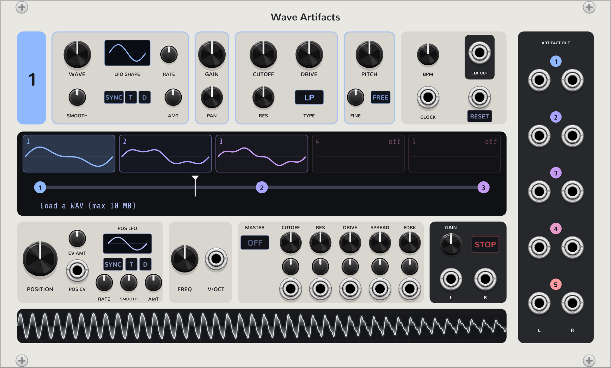
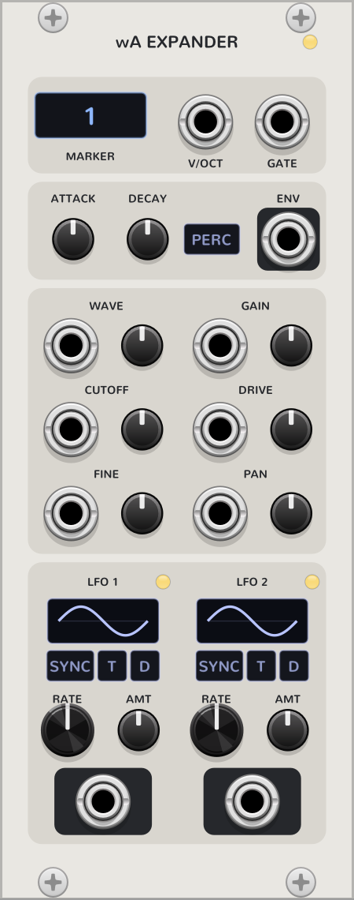

# Wave Artifacts

A VCV Rack 2 wavetable morph oscillator. It turns one imported WAV file (max 10 MB) into
50-100 single-cycle wavetables ("artifacts") and morphs between up to 5 user-placed markers.
A wavetable map along the bottom shows the whole sample, with each marker's bullet at the
artifact it plays. The **Wave Artifacts Expander** (up to 5, to the right) adds per-marker CV
inputs, a gate with an attack / decay envelope, and two LFOs.



*Wave Artifacts as it looks before a WAV is loaded. Top row: the selected marker's controls,
then the tempo section. Middle: the marker bar (the five slots, the bullets and the playhead).
Bottom: POSITION and its LFO, FREQ / V/OCT, the master section and the wavetable map.
Right: the five ARTIFACT OUT pairs.*

Each artifact also has its own stereo output (ARTIFACT OUT, right of the panel): its own chain
before the master section, at its share of the position crossfade (full level while the
playhead is on its marker, fading out toward the neighbors, silent elsewhere). Patching an
artifact's output takes that artifact out of the main L/R (a 20 ms fade, no click), so it
becomes a separate audio stream; unpatch it to bring it back. The screen tags it "OUT" while it
is routed out.

The plugin and module slugs stay `waveArtifact` and `waveArtifactExpander`, so patches saved
with earlier builds still load.

Status: playable. Oscillator, markers, per-artifact controls, master filter, internal tempo and
clock, artifact outputs and the expander (CV, gate envelope, LFOs) are done. Saving the loaded
WAV inside the patch is still to come.

## Quick start: your first patch

You need Wave Artifacts, something that sends pitch (and optionally a gate), and an audio
output. The smallest patch is just Wave Artifacts into **Audio**, which already makes sound.

1. **Add the module.** Right-click the rack, search for *Wave Artifacts* and add it.
2. **Load a WAV.** Click the screen where it says *Load a WAV (max 10 MB)* (or the file line
   at the bottom of the screen later on), or right-click the module and choose **Load WAV...**
   Any WAV works: a voice, a pad, a field recording. The module analyses it for a moment and
   the file line then shows the name and the number of artifacts, e.g. `pad.wav  64 artifacts`.
3. **Patch the output.** Cable **L** and **R** (bottom right of the main section, in the dark
   box next to STOP) to an **Audio** module's left and right inputs.
4. **Hear it.** The module starts with one marker, so you hear one wavetable at a steady pitch
   (C4 with the FREQ knob in the middle).
5. **Add markers.** Click an empty spot on the marker bar (the line with the bullets) to add a
   marker there, up to five. Each new marker picks the artifact under that spot of the sample.
   Or right-click the module and choose **Auto arrange artifacts** to place all five evenly.
6. **Move through them.** Turn **POSITION**, or drag the white playhead on the bar. The sound
   crossfades between the two markers the playhead is between. Drag a bullet to move a marker.
7. **Shape each marker.** Click a slot at the top of the screen (or a bullet) to select a
   marker. The panel's top row now edits that marker: WAVE (which artifact it plays) and its
   SMOOTH, the WAVE LFO, GAIN and PAN, CUTOFF / DRIVE / RES / filter TYPE, and PITCH / FINE.
   You can also click the wavetable map along the bottom to give the selected marker that
   artifact; double-click an artifact to audition it, right-click it to assign it to a marker.
8. **Play it.** Cable a keyboard or sequencer's **1V/oct** to **V/OCT** (0 V is C4). Turn the
   POSITION LFO's AMT up to have the playhead move on its own; with SYNC on it follows the
   internal tempo (BPM) or a clock patched to **CLOCK**.
9. **Finish the sound** with the master section: pick a filter type (OFF / LP / BP / HP /
   NOTCH), then CUTOFF, RES, DRIVE, SPREAD and FDBK, each with its own CV trimpot and jack,
   and the master GAIN. **STOP** fades every output to silence until you press it again.

Useful to know:

- **POS CV / CV AMT** move the playhead from a CV (0-10 V sweeps the whole bar).
- **NOTCH** (artifact and master filter) cuts a wide hole at CUTOFF. RES adds two resonant
  peaks on its sides (up to about +7.6 dB at full RES) while the hole stays fully deep. Sweep
  CUTOFF slowly (or modulate it from the expander) to hear it move through the harmonics.
- **RESET** (or a gate on the RESET jack) restarts the beat grid and every LFO; **CLK OUT**
  sends a 10 V trigger per beat.
- Right-click menu: *Artifact count* (50 / 64 / 100 or Auto), *Artifact tone* (Natural /
  Smooth / Soft), *Clock resolution* for the CLOCK input, *Restart LFOs* and *Add expander*.
- **Randomize** (right-click menu) leaves the STOP button alone and also randomizes the
  expanders snapped on to the right.
- To use the artifacts as separate voices, patch **ARTIFACT OUT 1-5**: each artifact then
  leaves the main L/R and plays on its own jacks, following the position.

## The expander



The **Wave Artifacts Expander** adds CV control to **one marker**. Choose which marker with the
**MARKER** button at the top (1-5).

### Adding one

Right-click Wave Artifacts and choose **Add expander** (it shows how many you have, up to 5),
or add *Wave Artifacts Expander* from the module browser and snap it against the right side of
Wave Artifacts (or of another expander). The LINK light at the top turns on when it is
connected. Added from the menu, an expander takes the first marker no other expander uses and
is placed in marker order: with an expander on marker 5, a new one gets marker 1 and sits
first, next to Wave Artifacts. Everything to its right moves over by one panel.

### What it does

From the top of the panel down:

- **V/OCT** adds pitch to this marker only (1 V/oct), on top of the main V/OCT.
- **GATE** turns the marker into a note: while the jack is patched, the marker sounds only
  while the gate is high (1 V or more) and is silent otherwise. Nothing is gated while it is
  unpatched.
- **ATTACK / DECAY** shape the gate (5 ms to 2 s and 5 ms to 4 s). At the minimum the gate
  opens and closes instantly (still click-free). The level holds while the gate is high and
  DECAY starts when it falls. **PERC** makes it a true AD: attack then decay even if the
  gate is held.
- **ENV** outputs the envelope (0-10 V) so you can patch it to cutoff or anything else. It
  reads 0 V without a gate.
- **CV inputs with an AMT trimpot** for WAVE, GAIN, CUTOFF, DRIVE, FINE and PAN. AMT starts at
  0, so nothing moves until you turn it up. At 100%, 10 V sweeps the whole sample for WAVE,
  the whole cutoff range (about 1 V/oct) for CUTOFF, the whole range for DRIVE, 2 semitones
  for FINE and hard left to hard right for PAN. **GAIN works as a VCA**: at AMT 0 it does
  nothing, at 100% the marker's level follows the CV (silent at 0 V, full at 10 V).
- **Two LFOs** (shape, RATE, AMT, SYNC / T / D) with their own outputs at +-5 V. Patch them
  anywhere, including the expander's own CV inputs. Synced LFOs follow Wave Artifacts' tempo
  or CLOCK, and restart on RESET.

Several expanders can control the same marker: their CVs add up, and their gates and GAIN
VCAs multiply (the marker sounds only while all of their gates are high).

### A first expander patch

1. Add an expander (right-click Wave Artifacts, **Add expander**) and make sure its MARKER
   shows the marker you want to move.
2. Patch **LFO 1** to the **WAVE** input and turn the WAVE **AMT** up to about 30%. The marker
   now sweeps through the sample's artifacts by itself.
3. To play that marker like a voice, send a keyboard's **gate** to **GATE** and its **1V/oct**
   to the main **V/OCT**. Set DECAY to a second or so and the marker rings out after each key.
   Turn PERC on for a pluck even if you hold the key. (In the main L/R you hear a marker
   while the POSITION playhead is on it, so park the playhead on that marker, or patch the
   marker's **ARTIFACT OUT** jacks, which follow the position the same way.)
4. For a second voice, add another expander: it gets the next free marker, ready for its own
   gate and CV.

## Build (Windows, MSYS2 MinGW 64-bit shell)

```bash
cd /e/Project/vcv-rack-plugins/waveArtifact
make            # RACK_DIR defaults to ../Rack-SDK-2.6.6-win-x64/Rack-SDK
make install    # copies the plugin into the Rack user folder
```

If the module does not appear in Rack, check `log.txt` in the Rack user folder.

## Offline tests (no Rack needed)

```bash
cd tests && make run
```

## Regenerating the images

The pictures in `docs/images/` are Rack's own module screenshots. With a Rack source build:

```bash
cd Rack && ./Rack.exe --dev --screenshot 3   # writes screenshots/waveArtifact/*.png, 3x zoom
```

Existing files are skipped, so delete the old PNGs first, then copy the new ones into
`docs/images/`.

## How the wavetables are made

`src/WavetableBank.cpp` splits the sample into N equal segments (Auto: 20 per second, clamped
to 50-100, or a fixed 50 / 64 / 100 from the context menu). For each segment it:

1. Detects the fundamental (McLeod normalized square difference function, 40 Hz-2 kHz).
2. Pitched segments: resamples one period to 2048 samples and averages up to 4 periods.
   Unpitched segments (noise): takes 2048 raw samples and crossfades the loop point.
3. Removes DC, drops harmonics the source could not contain, and rotates the phase so the
   fundamental starts at zero. Adjacent tables then morph without cancelling.
4. Builds 11 band-limited mip levels for alias-free playback at any pitch.

Analysis runs on a worker thread and is handed to the audio thread lock-free.

## Panel

Labels are drawn at runtime by `src/widgets/PanelLabels.hpp`, because panel SVGs must not
contain text and converting it to paths needs Inkscape. Once the panel is finished in
Inkscape (text converted with Path > Object to Path), remove `PanelLabels`.

## License

GPL-3.0-or-later. See LICENSE.txt. `src/dep/dr_wav.h` is public domain / MIT-0.
